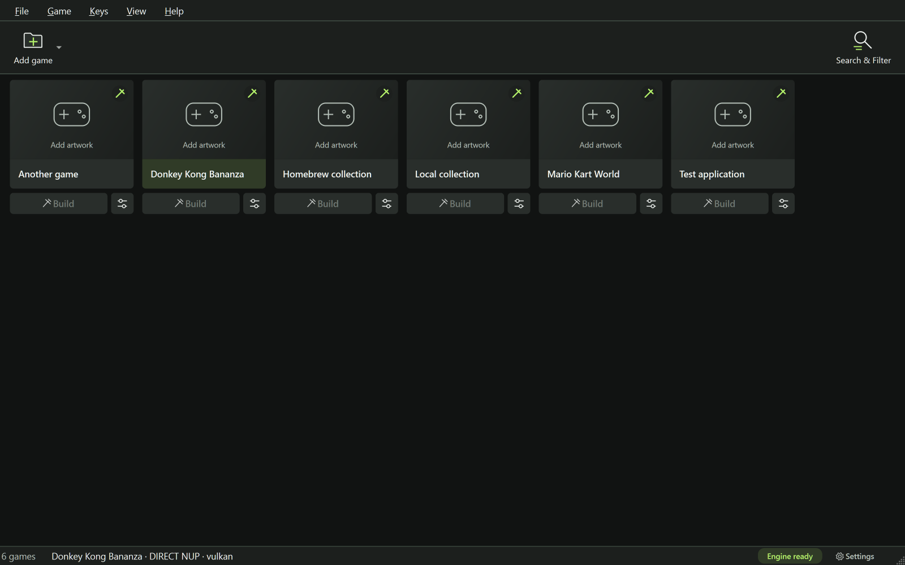
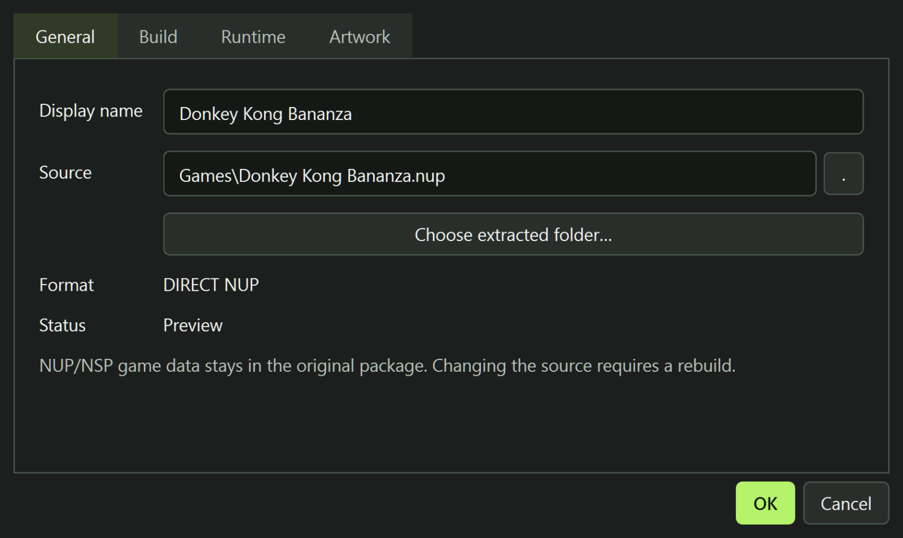
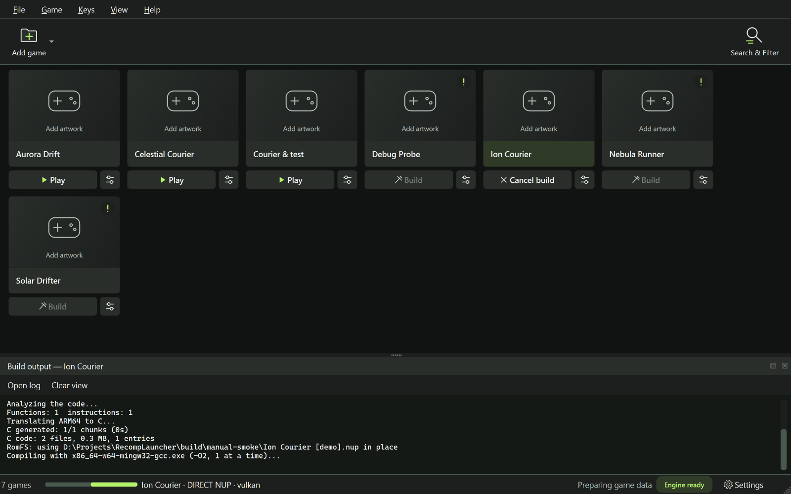
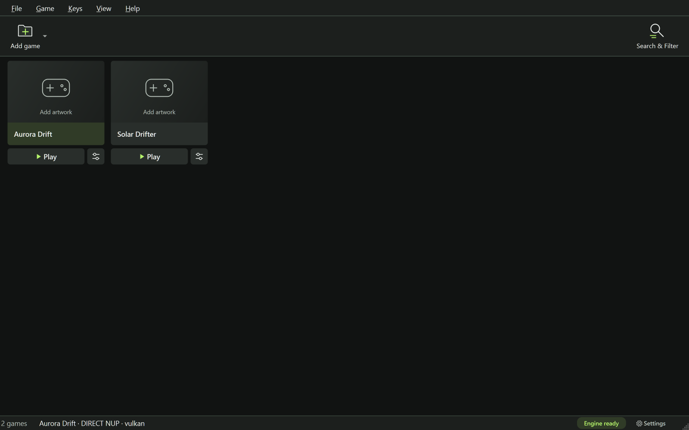
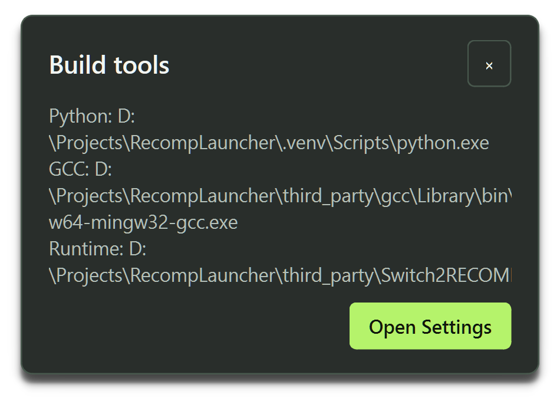
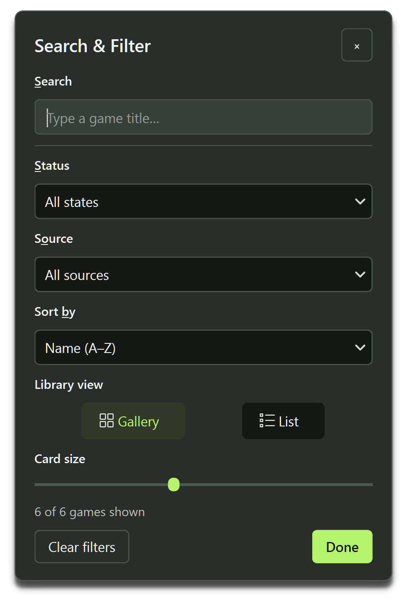
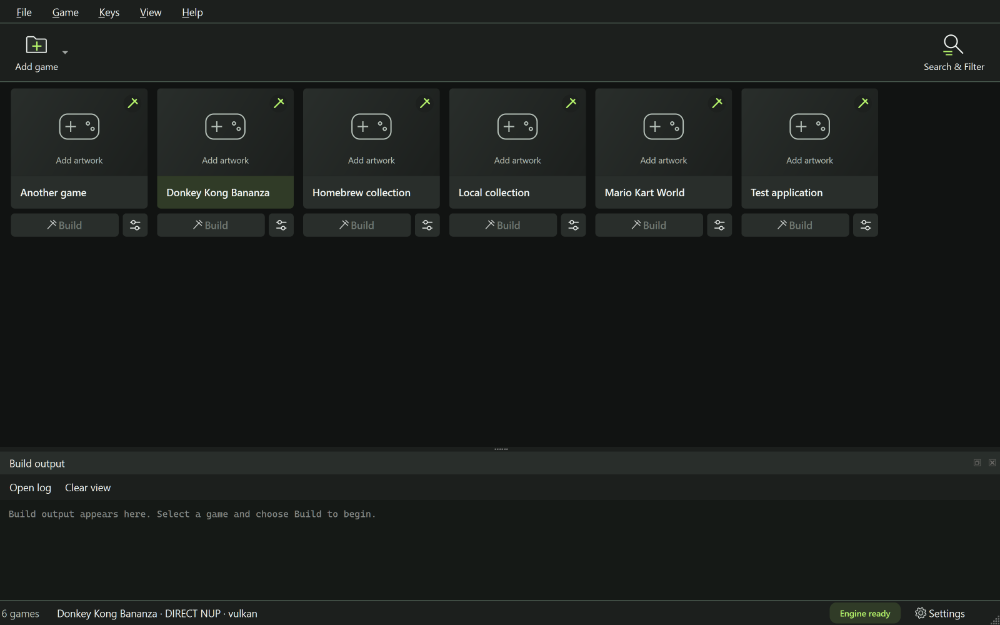
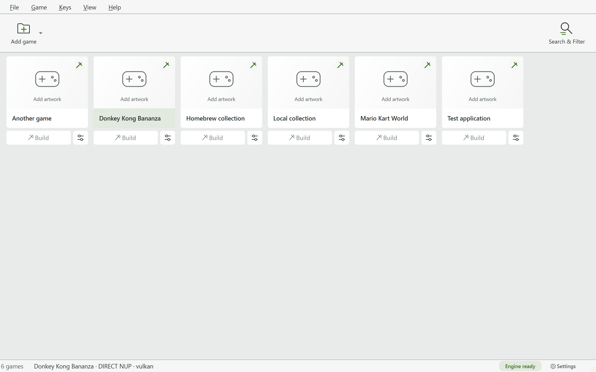

# SwitchRecomp Launcher

A native Qt desktop launcher and game library for the [Switch2RECOMP](third_party/Switch2RECOMP)
static recompiler. Add your own game dumps, recompile them to native Windows code, and launch the
finished games from the same library — no per-game desktop shortcuts. The library persists between
sessions; games run detached and keep running when the launcher closes.

It is a build tool and library frontend, not an emulator product. No games, keys, or firmware are
included or downloaded.



## Workflow — add, build, play

**1. Add a game.** Pick a `.nup`, supported `.nsp`, or `.nro` package, an extracted ExeFS folder, or
import a build you already compiled. Choose the display name and build location, then confirm.



**2. Build.** One click recompiles the game: ARM64 analysis, C translation, native compilation, and
linking. Live output streams into the console dock; progress stays in the status bar.



**3. Play.** The card's button becomes **Play** once artifacts are ready. Double-click a card or
press Enter. Games are detached processes; closing the launcher does not close your game.



The screenshots above show the launcher running against a real developer library built from
synthetic test packages. The gallery image uses the launcher's non-persistent preview data.

## Library features

- **Gallery and list views** with sorting, cover-art cards, and a size slider.

  

- **Search & Filter** popout: title search, state/source filters, sorting, view choice, and card
  size. Active filters are counted on the command and in the status bar.

  

- **Console dock** (View → View console, Ctrl+L) with live build output and an Open log shortcut.

  

- **Appearance**: dark and light themes with Lime, Mint, Violet, Rose, and Cyan accents, previewed
  immediately. This is the light theme:

  

- **Properties** per game: General (name, source, format, status), Build (output folder, workers,
  optimization), Runtime (OpenGL/Vulkan renderer), and Artwork (cover and background images).
- **Status bar** with the library count, build progress, selection details, and an engine health
  badge — click it to see exactly which tool is missing and jump to Settings.
- **Context menu** on every card: play, build, properties, folders, log, remove.
- **Keys menu** for installing `prod.keys` (required for direct NSP builds). Keys are copied to the
  launcher's private application-data folder and passed to builds via `SWR_PROD_KEYS`.

| Shortcut | Action |
|---|---|
| Ctrl+O | Add NUP/NSP/NRO |
| Ctrl+B | Build selected game |
| Ctrl+F | Search & Filter |
| Ctrl+L | View console |
| Alt+Enter | Properties |
| Enter / double-click | Play a ready game |
| F5 | Refresh library |

## Repository layout

```
src/launcher/                   Qt 6 C++ launcher (this app)
src/recomp_cli.py               build CLI entry point; drives the vendored engine
third_party/Switch2RECOMP/      engine submodule (turbo branch of the Switch2RECOMP-turbo fork)
third_party/gcc/                portable GCC 16.2 toolchain (not committed; see setup)
scripts/                        setup, build, run helpers
docs/                           build guide, launcher guide, engine notes
tests/                          launcher Python tests (workflow, release scripts, Python selection)
bin/launcher/                   deployed launcher (build output)
```

Launcher Python tests live in `tests/`; engine tests stay in `third_party/Switch2RECOMP/tests/`. The C++
test suites build with the launcher.

### The engine submodule

`third_party/Switch2RECOMP` is a git submodule pinned to a commit on the `turbo` branch of
[Switch2RECOMP-turbo](https://github.com/ChrisColeTech/Switch2RECOMP-turbo): upstream SwitchRecomp plus
the fork's engine enhancements, without the old Qt launcher. Clone with submodules:

```bat
git clone --recurse-submodules <this repo>
rem or, in an existing clone:
git submodule update --init
```

Engine changes are made and pushed in the fork, never only here. To pull upstream fixes and bump the pin:

```bat
rem in the fork checkout
git fetch upstream
git checkout main  && git merge --ff-only upstream/main && git push origin main
git checkout turbo && git merge main && git push origin turbo
rem here
git submodule update --remote third_party/Switch2RECOMP
rem rebuild + test, then commit the new pin
```

Merge (do not rebase) `turbo`: the pin is a commit id, and a rebase would orphan pinned commits.

## Building

Windows requirements: Visual Studio 2022 Build Tools with the MSVC x64 C++ toolset, Qt 6.8 MSVC
x64 (Core, Gui, Widgets, Test, plus the Qt Image Formats module), and Python 3.8+. CMake 3.31.10
and Ninja 1.13.2 are pinned into the project venv by setup.

```bat
scripts\setup.bat                 rem one-time: venv + pinned build tools + GCC check
scripts\build-runtime.bat         rem builds third_party\Switch2RECOMP\bin\runtime_win64_win32.exe
scripts\build-launcher.bat        rem builds, tests, and deploys Qt to bin\launcher
scripts\run-launcher.bat          rem start the launcher
```

Pass `-QtPrefix C:\Qt\6.8.3\msvc2022_64` to `build-launcher.bat` for a non-default Qt. Both
launcher CTest suites run automatically; full output lands in `logs\launcher_release.log`.

### Recompiling a game from the command line

```bat
scripts\build-from-nup.bat "D:\Games\Game [title][v0].nup" --outdir "D:\Games\Game-build" -o Game
"D:\Games\Game-build\Game.exe"
```

The output directory receives `Game.exe`, `Game_code.dll`, `Game.ini`, generated C in `Game_build/`,
and `Game_data/` with the ExeFS plus a `romfs.nup` pointer — the original package remains the only
RomFS copy and is read in place at runtime. NSP inputs need `prod.keys` installed first; use
`scripts\build-from-nsp.bat`.

## Testing

```bat
.venv\Scripts\python.exe third_party\Switch2RECOMP\tests\test_nup.py -v
.venv\Scripts\python.exe third_party\Switch2RECOMP\tests\test_nsp.py -v
.venv\Scripts\python.exe tests\test_python_selection.py -v
.venv\Scripts\python.exe tests\test_launcher_workflow.py -v
.venv\Scripts\python.exe tests\test_release.py -v
```

`test_release` covers the portable-release packaging contracts. Building, packaging and smoke-testing a
release bundle locally is described in [docs/RELEASES.md](docs/RELEASES.md).

`test_launcher_workflow` exercises the deployed launcher end to end: it imports an existing native
build without compiling, and drives a real build of a synthetic, game-data-free NUP through the
actual `BuildManager`/`QProcess` path, asserting the ready-to-play library entry persists.

## Licensing

The vendored engine keeps its own notices: AGPL-3.0, see
`third_party/Switch2RECOMP/LICENSE.txt` and `third_party/Switch2RECOMP/NOTICE.txt` (`legal/` in a release). The Qt
launcher source in `src/` is this repository's own work. Game builds stage the engine's shader
translation helper under the output directory; it requires the Python interpreter recorded at
build time and, only for the optional Vulkan renderer, .NET 10. The standard OpenGL runtime needs
neither.
