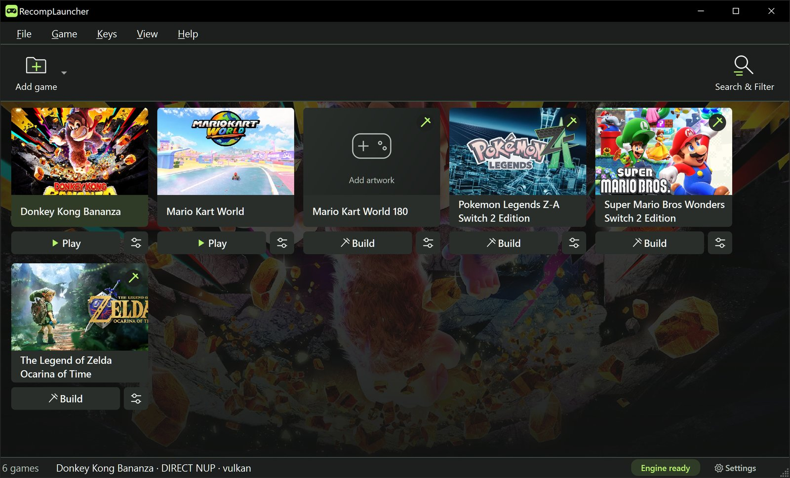
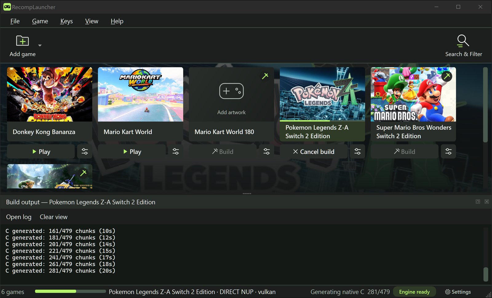

# RecompLauncher

A game library for the [Switch2RECOMP](https://github.com/ChrisColeTech/Switch2RECOMP-turbo) static recompiler.
Add your own Switch game dumps, build them into native Windows or Linux games with one click, and play them
from the same library.

## Download and run

1. Download the zip (Windows) or tar.gz (Linux) from the latest
   [release](https://github.com/ChrisColeTech/RecompLauncher/releases/latest).
2. Extract the whole archive into a writable folder.
3. Run `RecompLauncher.exe` (Linux: `./RecompLauncher`).

Everything a build needs ships in the archive: Python, GCC, .NET and the shader tools. Nothing else to install.

## What you need

- **Your own game dumps**: `.nup` packages, supported `.nsp` packages, homebrew `.nro`, or an extracted folder
  with `exefs/main`. No games, keys or firmware are included or downloaded.
- **`prod.keys`** for `.nsp` builds, installed once with **Keys → Install keys…**. Encrypted, sparse and
  update-only NSPs are not supported ([details](docs/NSP_IN_PLACE.md#supported-packages)).
- **A 64-bit CPU with AVX2** and a GPU driver with Vulkan support. On Linux: Ubuntu 24.04 or newer, with X11 or
  XWayland.

## Add, build, play

1. **Add** — click **Add game** (Ctrl+O), or drag a package onto the window. Use the arrow next to it for an
   extracted folder or a game you already built.
2. **Build** — click **Build** on the card (Ctrl+B). The first build takes a while; progress shows on the card
   and the full output in the build panel.
3. **Play** — the card's button turns into **Play** (or double-click the card).

## Good to know

- **Keep your game files where they are.** Builds read the game's data straight from the original package, so
  moving or deleting it breaks the build.
- **Games run on their own.** Closing the launcher doesn't close a running game.
- **Cover art**: open a game's properties (the sliders button, or Alt+Enter) → **Artwork**. The selected game's
  art also fills the background.
- **Renderer**: Vulkan by default, OpenGL as an alternative, per game in properties → **Runtime**.
- **Controller buttons**: Settings → **Controller** chooses Switch (by position, the default; Circle = A on a
  PlayStation pad) or Xbox (by label, Cross = A); properties → **Runtime** can override it per game.
- **Settings** (bottom right) has the theme and accent color, the default build folder and worker count.
  The **Engine ready** badge next to it tells you if a build tool is missing.

| Shortcut | Action |
|---|---|
| Ctrl+O | Add game |
| Ctrl+B | Build selected game |
| Enter / double-click | Play |
| Alt+Enter | Properties |
| Ctrl+F | Search & Filter |
| Ctrl+L | Build output |
| F5 | Refresh library |

## Building from source

See [docs/DEVELOPING.md](docs/DEVELOPING.md). Release notes for every build are on the
[releases page](https://github.com/ChrisColeTech/RecompLauncher/releases).

## License

The engine is SwitchRecomp by MZ Labs, AGPL-3.0; its notices are in `legal/` in a release and in
[third_party/Switch2RECOMP](third_party/Switch2RECOMP) in the source.
